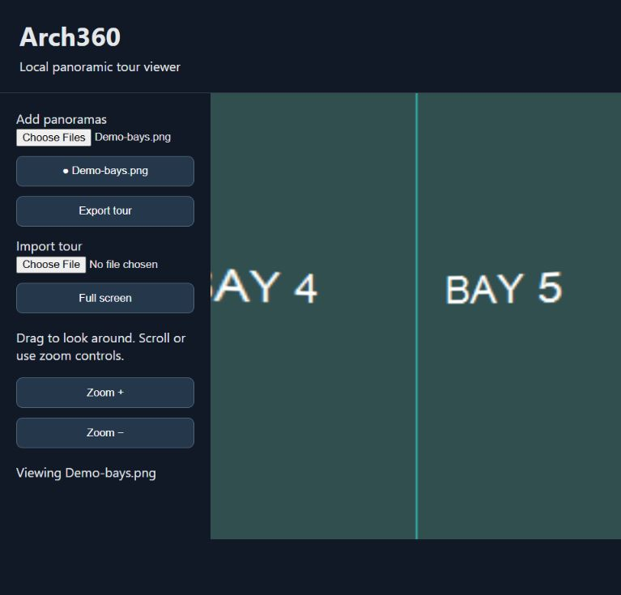

# Arch360
A dependency-free WebGL viewer for architectural equirectangular panoramas. Open index.html in a modern browser, add your own 2:1 JPEG or PNG renders, and select rooms. Drag or use arrow keys to look around; use zoom buttons or scroll. Export saves a JSON tour containing the images; import restores it. Images stay in the browser unless you share the exported file. Only share images you have permission to distribute. Fullscreen depends on browser support. This initial prototype does not include hotspots, VR or hosted storage. No sample client imagery is included.

[Open the live demo](https://ameer93emad-dev.github.io/architecture-virtual-tour/)

## Try the demo

Load a 2:1 panoramic image, select its room, and use the zoom controls to inspect a detail. Export the tour to keep a local copy. The screenshot uses a generated calibration panorama with numbered bays.

